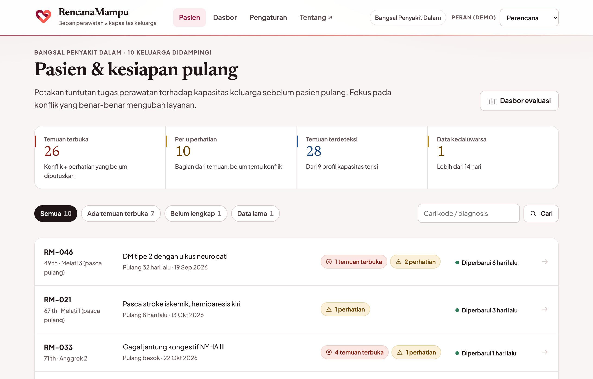
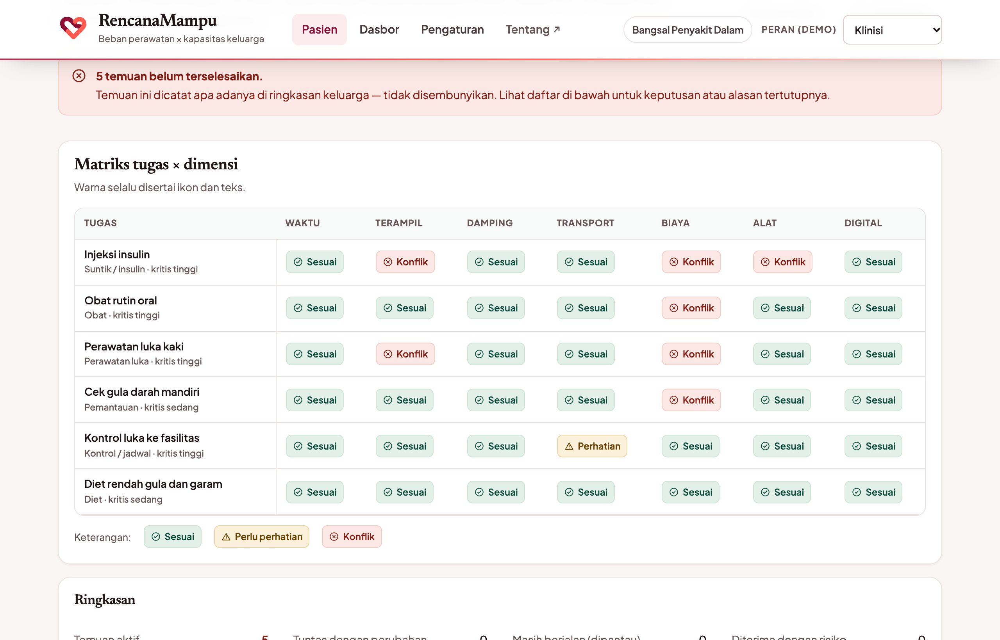
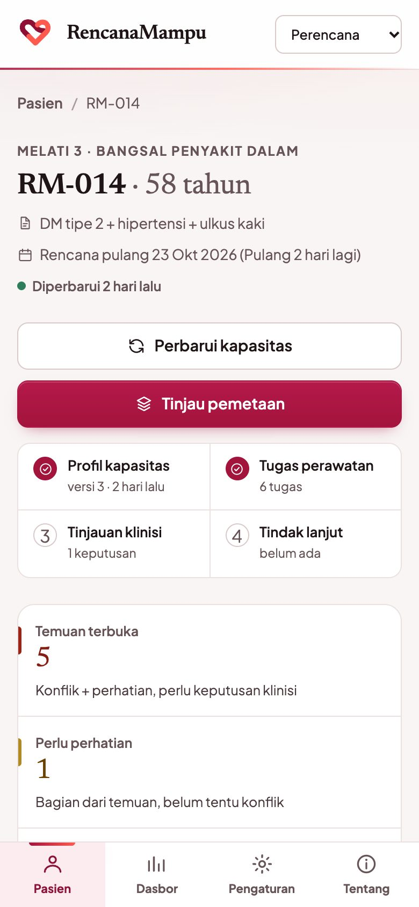
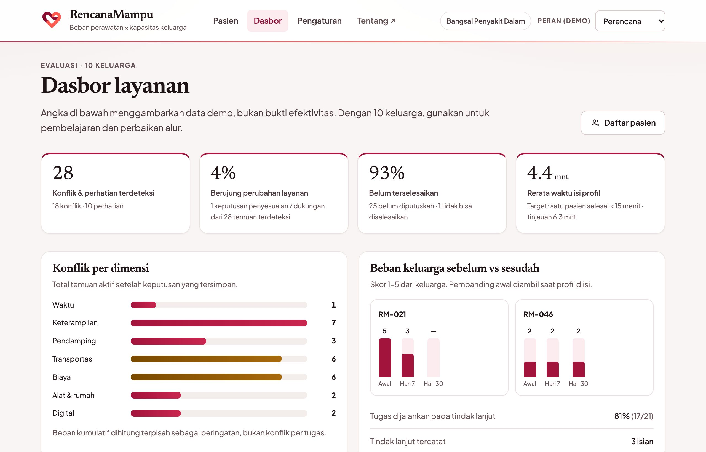

<div align="center">

# RencanaMampu

**Rencana pulang yang benar-benar sanggup dijalankan keluarga.**

Alat bantu perencanaan pemulangan pasien: memetakan beban tugas perawatan di rumah terhadap kapasitas nyata keluarga, menunjukkan di mana keduanya berbenturan, lalu mencatat keputusan klinisi untuk menyesuaikan rencana atau menambah dukungan.




</div>

> [!IMPORTANT]
> **Alat bantu perencanaan, bukan alat klinis.** RencanaMampu tidak mengubah dosis, tidak menyarankan terapi, dan tidak menggantikan keputusan klinisi. Prototipe ini memakai **data fiktif** dan menyimpan data di peramban tanpa enkripsi.

## Masalahnya

Rencana pulang sering lengkap secara klinis, tetapi gagal di rumah: insulin dua kali sehari padahal tidak ada kulkas, kontrol empat kali sebulan padahal ongkos ojek melebihi kemampuan, perawatan luka terlatih padahal pendamping bekerja shift. Benturan seperti ini biasanya baru ketahuan saat pasien kembali dirawat.

RencanaMampu membuat benturan itu terlihat **sebelum** pasien pulang, lengkap dengan alasan dan angkanya, supaya tim bisa memilih: sederhanakan rencana, tambah dukungan, atau terima risikonya secara sadar.

## Fitur utama

| | Fitur | Yang dilakukan |
|---|---|---|
| 🧭 | **Profil kapasitas keluarga** | Formulir percakapan 5 langkah (± 5 menit): pendamping dan jam nyata mereka, transportasi, kemampuan biaya, kondisi rumah, sarana digital. Persetujuan dicatat lebih dulu, bisa disimpan sebagian, dan setiap simpan menjadi versi bertanggal. |
| 💊 | **Tugas perawatan dari templat** | 12 templat sekali ketuk (insulin, perawatan luka, NGT, kontrol, diet, mobilisasi, dll.), lalu sesuaikan frekuensi, durasi, keterampilan, biaya, dan tingkat kritis. |
| 🧩 | **Matriks tugas × 7 dimensi** | Waktu, keterampilan, pendamping, transportasi, biaya, alat & rumah, digital. Setiap sel *Sesuai / Perhatian / Konflik* selalu memakai ikon dan teks, bukan warna saja. |
| 🔎 | **Konflik yang bisa ditelusuri** | 8 aturan deterministik, tanpa AI. Setiap temuan menampilkan alasan berbahasa sederhana, nilai aktual vs ambang, dan `ruleId`, diurutkan dari tugas paling kritis. |
| ✅ | **Keputusan klinisi** | *Rencana disesuaikan · Dukungan ditambah · Diterima dengan risiko · Tidak bisa diselesaikan*, dengan opsi dari katalog layanan. Pemetaan dihitung ulang dan menampilkan **sebelum vs sesudah**. |
| 🖨️ | **Ringkasan untuk keluarga** | Satu halaman bahasa awam, siap **Cetak / Simpan PDF**. Temuan yang belum beres tetap dicantumkan, tidak disembunyikan. Ada juga **tautan keluarga** hanya-baca yang kedaluwarsa dalam 3 hari. |
| 📅 | **Tindak lanjut hari 7 & 30** | Tugas yang benar-benar dijalankan, kendala nyata, skor beban 1–5 dibanding skor awal, dan rawat ulang tak terencana. |
| 📊 | **Dasbor evaluasi** | Konflik per dimensi, persentase temuan yang berujung perubahan layanan, alasan tidak terselesaikan, beban sebelum/sesudah, waktu pengisian, dan umpan balik klinisi. |
| ⚙️ | **Pengaturan layanan** | Semua ambang dan katalog opsi di satu tempat, bisa diubah admin, plus log audit akses dan perubahan. |
| 👥 | **Tiga peran demo** | Perencana, klinisi, dan admin dengan hak berbeda (simulasi alur, bukan autentikasi). |

<table>
<tr>
<td width="68%"></td>
<td width="32%"></td>
</tr>
<tr>
<td align="center"><sub>Matriks tugas × dimensi</sub></td>
<td align="center"><sub>Responsif sampai lebar 320px</sub></td>
</tr>
</table>



## Coba dalam satu menit

Butuh **Node 20.19+**. Tidak perlu database atau kunci API.

```bash
git clone https://github.com/sellebeww/RencanaMampu.git
cd RencanaMampu
npm install
npm run dev          # http://localhost:5173
```

Alamat polos membuka **profil produk**; tombol **Buka aplikasi** masuk ke daftar pasien. Pilih peran di kanan atas:

| Peran | Bisa melakukan |
|---|---|
| **Perencana** pemulangan | Mengisi profil kapasitas, mengelola tugas, melihat pemetaan, membuat tautan keluarga, mengisi tindak lanjut |
| **Klinisi** penanggung jawab | Semua di atas, ditambah mencatat keputusan konflik dan umpan balik |
| **Admin** layanan | Mengubah ambang, mengaktifkan/menonaktifkan opsi katalog, mengatur ulang data demo |

Pasien yang menarik untuk dicoba: **RM-077** (konflik terbanyak), **RM-014** (konflik biaya yang tidak bisa diselesaikan), **RM-021** (sudah ada tindak lanjut), **RM-102** (belum punya profil).

| Perintah | Fungsi |
|---|---|
| `npm run dev` | Server dev dengan hot reload |
| `npm test` | 35 uji mesin aturan (Vitest) |
| `npm run typecheck` | `tsc --strict`, tanpa emit |
| `npm run build` | Typecheck + build statis ke `dist/` (bisa di-host di subfolder mana pun) |
| `npm run preview` | Sajikan `dist/` secara lokal |

Uji aturan juga bisa dibuka di peramban lewat `/tests.html`.

## Alur kerja satu pasien (± 15 menit)

```
Daftar pasien → Profil kapasitas → Tugas perawatan → Pemetaan & keputusan → Ringkasan keluarga → Tindak lanjut 7/30 → Dasbor
                    ± 5 menit          ± 3 menit          ± 5 menit           cetak / tautan       pascapulang
```

## Aturan konflik

Semua ambang ada di [`src/config.ts`](src/config.ts) dan dapat diubah dari halaman **Pengaturan**. Mesin aturan [`src/rules.ts`](src/rules.ts) berupa fungsi murni dan deterministik.

| Kode | Aturan | Tingkat |
|---|---|---|
| R1 | Total tuntutan tugas harian > jam pendamping tersedia, atau melewati batas jam layanan | konflik; perhatian bila ≥ 85% |
| R2 | Tugas “terlatih” tanpa pendamping dengan keterampilan sejenis; literasi terbatas untuk tugas dasar | konflik / perhatian |
| R3 | Tugas butuh pendamping, tetapi pendamping bekerja pada slot itu atau tidak ada | perhatian / konflik |
| R4 | Tidak ada transportasi, menit perjalanan kontrol/bulan > ambang, atau pasien tidak bisa pergi sendiri | konflik / perhatian |
| R5 | Total biaya tugas + transport/bulan > kemampuan keluarga | konflik; perhatian bila ≥ 85% |
| R6 | Syarat rumah (listrik, kulkas, air, ruang) tidak tersedia | konflik |
| R7 | Tugas butuh ponsel/WhatsApp/video call yang tidak tersedia | konflik |
| R8 | Jumlah tugas harian > ambang beban kumulatif | perhatian |
| — | Data kapasitas lebih dari 14 hari | peringatan + ajakan perbarui |

Opsi katalog membawa efek terstruktur (mis. kunjungan rumah menghapus kebutuhan transport; gabung jadwal memotong frekuensi kontrol). Efek **hanya** diterapkan setelah klinisi menyimpan keputusan *sesuaikan* atau *dukungan*. Status *risiko* dan *tidak bisa diselesaikan* tidak mengubah data.

## Data demo

10 keluarga fiktif ([`src/data.ts`](src/data.ts)) mencakup kapasitas cukup, satu konflik, banyak konflik, dan pasien tanpa profil; konflik di semua dimensi; data kedaluwarsa dan draf; keputusan tersimpan; serta tindak lanjut hari 7/30. Kode `RM-xxx` adalah pseudonim; tidak ada nama pasien nyata.

## Teknologi & struktur

TypeScript (strict) tanpa framework UI, dibangun dengan Vite dan diuji dengan Vitest. Tampilan dirender sebagai string HTML dengan delegasi event; data disimpan berversi di `localStorage`.

```
index.html          aplikasi (router hash)          src/app.ts        router, event, validasi formulir
profil.html         profil produk / landing         src/views.ts      semua tampilan
styles.css          design system + gaya cetak      src/rules.ts      mesin aturan + format angka/tanggal
tests.html          uji aturan di peramban          src/config.ts     ambang + katalog opsi
docs/schema.sql     usulan skema PostgreSQL         src/store.ts      penyimpanan, audit, consent, tautan keluarga
docs/privasi.md     privasi & batas kepatuhan       src/data.ts       10 keluarga + 12 templat
docs/pilot.md       protokol pilot & metrik         src/types.ts      tipe domain
docs/audit/         laporan audit + skrip verifikasi
```

## Aksesibilitas & keamanan

- **Aksesibilitas:** diuji dengan axe-core (WCAG 2.2 A/AA, 0 pelanggaran) di lebar 390px dan 1280px. Status tidak pernah bergantung pada warna saja; ada navigasi keyboard, *skip link*, dan cincin fokus yang jelas; animasi mati bila pengguna memilih *kurangi gerakan*.
- **Content-Security-Policy** lewat `<meta>`: skrip hanya dari berkas lokal, tanpa skrip inline, tanpa koneksi jaringan selain Google Fonts.
- **Escaping:** semua teks dinamis lewat helper `e()`; skrip verifikasi menguji payload XSS di 68 rute.
- **Privasi:** consent per profil, log audit, dan tautan keluarga berkedaluwarsa yang tidak membuka data kapasitas rinci. Lihat [`docs/privasi.md`](docs/privasi.md).

## Batasan prototipe

- Belum ada backend, database tersentral, autentikasi nyata, enkripsi at-rest, maupun API. Peran hanya simulasi.
- PDF dibuat lewat dialog cetak peramban, bukan di server.
- Belum ada penghapusan/ekspor data dan pencabutan tautan dari UI.
- Ambang awal (3 jam, 240 menit/bulan, 7 tugas) adalah asumsi, bukan norma klinis.
- Belum ada uji lapangan dan validasi klinis.

Asumsi, definisi metrik, protokol uji coba 10 keluarga, dan keputusan desain yang masih terbuka ada di [`docs/pilot.md`](docs/pilot.md).
